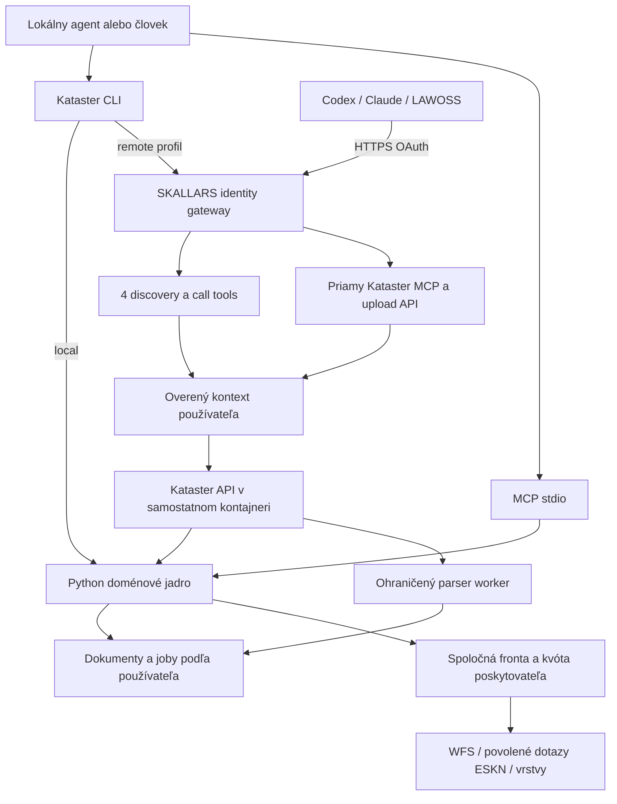

# Kataster: CLI, MCP, SKALLARS remote a LAWOSS distribúcia

Pracovný návrh z 12. 10. 2026. Výsledok prieskumu, nie implementácia ani potvrdenie kompatibility konkrétneho vydania v klientovi. Rozsah objednávky: navrhnúť použitie na ďalšom počítači, v rôznych harnesses, pre kolegu v SKALLARS a neskôr cez LAWOSS Marketplace ako local aj remote. Tento dokument rozširuje pôvodný `remote-dokploy.md`.

**Neskoršie upravené smerovanie:** [najprv samostatný súkromný Kataster](standalone-first-2026-10-12.md), priamo pripojený do Codexu/Claude Code a nasadený na používateľovom Dokploy. Gateway až ako ďalšia voliteľná integrácia. Tento novší dokument má prednosť pred nižšie uvedeným odporúčaním zapojiť gateway do prvého pilotu.

## Odporúčané rozhodnutie

Zachovať Python jadro upstreamu a vytvoriť nad ním tri adaptéry: doménové CLI, lokálne MCP stdio a vzdialené MCP/HTTP. SKALLARS prevádzku postaviť na existujúcom prihlásení a členstve SKALLARS gateway, ale Kataster spustiť v samostatnom kontajneri s vlastnou autorizáciou dokumentov. LAWOSS distribuovať z toho istého vydania ako lokálny balík a osobitný remote balík s výslovnou voľbou prevádzkovateľa.

CLI odporúčam ako prvotriedne rozhranie pre Codex, Claude Code a lokálny LAWOSS. MCP zostáva potrebné pre cloudových klientov a používateľov bez shellu. Neprepisovať parsery do TypeScriptu alebo Rustu iba kvôli distribúcii.

| Variant | Výhoda | Cena a obmedzenia | Rozhodnutie |
|---|---|---|---|
| Samostatný Python HTTP MCP s novým prihlasovaním | Jednoduchá hranica služby, samostatná distribúcia | Druhý systém účtov, súhlasov a odvolávania prístupu | Umožniť pri self-hostingu, pre SKALLARS teraz nepreferovať |
| Python jadro + CLI + samostatný backend za SKALLARS gateway | Využije existujúce členstvo, šetrí kontext, zachová local aj remote | Treba preniesť identitu do backendu a doplniť upload | Odporúčaný variant |
| Iba CLI + skill | Malý vstupný kontext, vhodné na súbory a dávky | Cloudový chat ho nevie všeobecne spustiť; inštalácia na každom stroji | Voliteľný spôsob používania, nie jediná distribúcia |

## Čo je aktuálne overené

| Komponent | Zistenie | Hranica dôkazu |
|---|---|---|
| Kataster 0.2.0 | Python >=3.12, 11 tools, stdio, `mcp[cli]>=1.2.0,<2`, lock 1.30.0; žiadny SKILL.md ani doménové CLI | Lokálny kód a AST; aplikačný server ani portál sa v tejto previerke nespúšťali |
| Slov-Lex, ORSR, Judikáty | Node/TS, SDK 1.30.x, HTTP/OAuth vzory; skilly existujú | Lokálne checkouty `323ab96`, `05244f5`, `c3e6d5f`; verzia nasadeného kódu sa tým nedokazuje |
| Judikáty | `view=compact/standard/full`, voliteľné sekcie a okná dlhého textu | Vhodný existujúci vzor pre odpovede Katastra |
| SKALLARS gateway | Dokploy eviduje službu `done`; HTTPS discovery odpovedá, issuer má PKCE S256, DCR, resource metadata, revokáciu a `sub` | Discovery nie je prihlásenie ani úspešné volanie nástroja |
| Zdroj gateway | `originalmagneto/skallars-marketplace`, commit `8a1219227b6dff2d41a36c715866b07225e9b60b`; 4 hub tools, lazy backendy, individuálne členstvo, Google Workspace | Prečítaný zdroj a dokumentácia; zhodnosť nasadeného image s týmto commitom nebola overená |
| LAWOSS Marketplace | Commit `491cd0f`: 15 runtime pluginov plus gog skill-only; local MCP + skill + generické CLI | README, manifesty, launcher a validátor |
| LAWOSS aplikácia | `dev`, commit `c7490d4f`: HTTP/OAuth kód aj mock E2E testy, osobitná podpora bundled Node pluginov | Statické čítanie; tieto testy teraz neboli spustené |
| LAWOSS registry | Commit `e53f7a6`: samostatná metadata vrstva, preview/review režim | Nie je runtime inštalátor |
| MCP CLI API Manager | Read-only inventár a porovnávanie integrácií, Tailscale-only, single-user MVP | Vhodný na neskoršiu kontrolu inštalácií, nie ako autentifikačný alebo dátový backend Katastra |

Vlastný OAuth verejných registrov nemožno automaticky považovať za identitu konkrétneho advokáta. Napríklad ORSR a Judikáty majú v prečítanom kóde autorizačnú bránu s heslom a grantmi klientov. Kataster potrebuje vlastníka uloženého dokumentu. Naopak SKALLARS gateway už vracia overené `memberId`, kontroluje aktívne členstvo a grant pri každej požiadavke. Je to vhodnejší základ.

Dokumentácia gateway uvádza 22 služieb/135 schválených nástrojov a stav PRIVATE_DRAFT/NOT_AVAILABLE do akceptácie druhým skutočným členom. Je to prevzatý stav vydania, nie dnes zopakovaný test. Verejný marketplace má v inom rozsahu 143 lokálnych nástrojov; čísla nemožno zamieňať.

## SDK a protokol

K 12. 10. 2026 je najnovšie stabilné oficiálne Python MCP SDK **2.3.0**, vydané 2. 10. 2026, potvrdené GitHub release aj PyPI. TypeScript SDK má stabilné **2.3.1**, vydané 5. 10. 2026. Aktuálna špecifikácia je **2026-07-28**. Kataster teda nemá najnovšie SDK. Číslo knižnice, revízia protokolu a verzia pluginového manifestu sú tri samostatné veci.

Navrhujem samostatnú migráciu na presne zamknuté Python SDK 2.3.0 pred remote implementáciou. Pri začatí migrácie opäť skontrolovať aktuálny patch a advisory. Oficiálne v2 mení `FastMCP` na `MCPServer`, importy výnimiek, niektoré návraty testov a typové polia; transport používa `httpx2`. Nezamieňať oficiálne SDK s osobitným balíkom `fastmcp`. Súčasné priame upstream HTTP volania Katastra môžu zatiaľ zostať na vlastnom `httpx`, ak lock a testy potvrdia súbeh.

Jedna HTTP aplikácia SDK v2 podľa dokumentácie obslúži moderný protokol 2026-07-28 aj starších klientov s `initialize` handshake. Preto nevyžadovať upgrade všetkých harnesses naraz. Použiť bezstavové spracovanie, keďže jadro nepotrebuje sampling ani klientský backchannel; stav dokumentov a jobov patrí do databázy, nie do MCP session.

Migrácia gateway na TS v2 je samostatná zmena s vlastnými testami. Python v2 backend s legacy kompatibilitou sa môže pripájať aj k existujúcemu gateway klientovi v1.30. Neoznačiť preto automaticky celú cestu cez gateway za protokol 2026-07-28. Priamy `/kataster/mcp` proxy endpoint môže zachovať protokolové hlavičky a nechať protokol obslúžiť Python; konkrétnu kombináciu treba otestovať.

Zdroje: [Python release](https://github.com/modelcontextprotocol/python-sdk/releases/tag/v2.3.0), [TypeScript release](https://github.com/modelcontextprotocol/typescript-sdk/releases/tag/v2.3.1), [migračný návod](https://py.sdk.modelcontextprotocol.io/migration/), [obsluha starších klientov](https://py.sdk.modelcontextprotocol.io/run/legacy-clients/), [špecifikácia](https://modelcontextprotocol.io/specification/2026-07-28).

## Cieľová architektúra



Diagram zobrazuje spoločný kód, nie spoločný disk lokálnej a vzdialenej inštancie. Local pracuje s lokálnym stavom; remote so serverovým. Prepnutie profilu nič automaticky nesynchronizuje ani neuploaduje.

### SKALLARS gateway a prenos identity

- Pre každodennú prácu so všetkými registrami použiť existujúce 4 hub tools: list services, search tools, describe tool, call tool. Kataster pridať ako jednu službu do schváleného katalógu až po testoch.
- Pre samostatné použitie sprístupniť aj priamy Kataster MCP endpoint. Návrh cesty na existujúcom hoste je `/kataster/mcp`; nejde o už existujúce nasadenie. Tým ostanú konkrétne schémy, anotácie a schvaľovanie operácií priamo viditeľné klientovi.
- Dnešné `mountMcp` používa `memberId` na autorizáciu a limit, ale `backend.callTool` ho neposiela. `createHub` drží jeden backend podľa služby a nemá používateľský kontext. Kataster sem nemožno bezpečne pridať iba novým riadkom katalógu.
- Zaviesť typovaný interný `RequestIdentity`, ktorý vznikne po autentifikácii a nikdy nie z `arguments`. Pri izolovanom backend kontajneri použiť krátkodobé podpísané interné poverenie s overeným členom, pracovným priestorom, scopes, presným interným audience, expiráciou a obmedzením použitia. Odstrániť klientom dodané identity hlavičky; backend overuje podpis aj oprávnenie konkrétnej operácie. Transport medzi kontajnermi tiež autentifikovať a sieťovo obmedziť.
- Existujúce gateway access tokeny sú opaque. Nestačí ich overovať cez JWKS a nemožno ich bez rozmyslu poslať inej audience. Overenie zostane pri gateway `auth.authenticate`; priamy resource `/kataster/mcp` musí byť výslovne registrovaný v jej resources. Jeden používateľský login môže slúžiť obom vstupom, OAuth grant/audience sú však odlišné.
- Job zdedí autorizovaný kontext pri vytvorení. Pred vykonaním citlivej fázy a vydaním výsledku skontrolovať aktívne členstvo/oprávnenie; samotný už uložený job nesmie obísť neskoršie odvolanie prístupu.
- Gateway runtime pre verejné registre dnes zdieľajú kontajner a UID. Kataster parser a osobné úložisko umiestniť osobitne; adresár na používateľa sám osebe nie je izolácia procesu.
- Generický `skallars_call_tool` skrýva klientovi konkrétnu operáciu za jednou schémou. Server musí sám presadzovať scopes a povolené operácie. Nepovažovať ho celý za read-only, keď pribudnú importy alebo mazanie. Citlivé mazanie/zdieľanie zaradiť do explicitného UI/priameho API, kým gateway nemá spoľahlivé potvrdenie konkrétnej akcie.

Pre SKALLARS odporúčam využiť už existujúci Google Workspace login s individuálnym schválením členov, nie zavádzať ďalší Keycloak len pre Kataster. Kancelárska doména samotná nestačí na prístup. CIMD doplniť ako samostatné rozšírenie existujúceho providera; live metadata dnes inzerujú DCR, nie CIMD. DCR zachovať pre klientov, ktorí ho potrebujú, spolu s limitmi registrácií. Podporu CIMD poskytovateľovi nevyhlásiť skôr než prejde testom.

Pre self-hosting definovať provider-neutral overovacie rozhranie. Keycloak je možnosť, ale jeho dokumentácia stále označuje CIMD a Resource Indicators ako experimentálne. Nie je dôvod vnucovať tento nový prevádzkový záväzok prvému dvojčlennému pilotu.

Zdroje: [MCP authorization](https://modelcontextprotocol.io/specification/2026-07-28/basic/authorization), [OpenAI OAuth požiadavky](https://developers.openai.com/plugins/build/auth), [Claude OAuth požiadavky](https://claude.com/docs/connectors/building/authentication), [Keycloak MCP](https://www.keycloak.org/securing-apps/mcp-authz-server).

### Úložisko, upload a životnosť

Prvý pilot: jedna replika API, jeden fetch worker a ohraničený parser worker; SQLite na lokálnom persistentnom volume s transakciami/WAL a krátkymi zápismi. SQLite používať cez jasné connection hranice; nekopírovať živý `.sqlite` bez WAL-aware backupu. Pre viac hostiteľov/replík prehodnotiť PostgreSQL a frontu. Redis ani S3 nie sú nevyhnutnou podmienkou dvoch používateľov.

Doménové objekty: `Principal`, `Workspace`, `Membership`, `Document`, `DocumentVersion`, `ParsedLV`, `Job`, `Artifact`. Každý osobný objekt má vlastníka a workspace. Predvolene každý člen vidí iba vlastné LV, aj keď obaja patria do SKALLARS. Zdieľaný spis bude samostatná explicitná funkcia s oprávneniami; samotné členstvo v kancelárii údaje nesprístupní.

`file_id`, `document_id`, `job_id` a `artifact_id` sú nepriehľadné identifikátory. Nie sú oprávnením. Každý read, list, import, export a download znovu kontroluje prístup. Dedup osobných súborov len v rámci oprávneného priestoru. Verejnú geometriu možno cacheovať spoločne; odpovede vlastníkov, LV a informáciu o existencii cudzieho dokumentu nie.

Upload rieši malé HTTPS API so streamovaním súboru mimo LLM: vybrať súbor v upload stránke alebo použiť CLI. Browser rieši vlastnú autentifikovanú session; nemožno predpokladať, že odkaz otvorený z chatu nesie MCP bearer token. API vráti `file_id`, potom sa spustí import a vráti stručný súhrn. Remote schéma nikdy neprijíma `path`, `paths`, `out_dir`, ľubovoľné URL na fetch ani celé PDF v base64. Toto sa musí vynútiť na backendovej hranici, nie iba skryť v tools/list.

Príloha v Claude/Codex nie je automaticky súborom na našom serveri. Prvá univerzálna cesta je upload stránka a CLI. MCP Apps/File Extensions sú neskoršie zlepšenie po overení podpory hosta; základný workflow od nich nezávisí.

Navrhované počiatočné limity na zmeranie: zachovať max. 20 MiB na súbor, remote batch max. 20 súborov a 100 MiB spolu, 200 strán/PDF, 30 s CPU/wall limit parsovania podľa testov, jeden aktívny parser job na člena, dva spolu. Ide o nové konzervatívne návrhové limity, nie odmeranú kapacitu. API nesmie držať všetky bytes dávky v RAM. Worker bez siete, s obmedzenou RAM/CPU a dočasným adresárom; upload HTML sa nikdy priamo nevykonáva ako stránka na prihlasovacej doméne.

Retencia v pilote: pôvodné uploads a osobné odvodené dáta najviac 7 dní; exportné linky minúty, exportné súbory najviac 24 hodín. Vymazanie po importovaní možno nastaviť, ale zhorší reparse a audit, preto musí byť explicitné. Periodický purge s metrikou posledného behu, zmazanie dát na požiadanie a politika rovnakej maximálnej životnosti šifrovaných záloh. Čítanie neobnovuje retenciu. UI ukáže expiry; používateľ si dlhodobý dôkaz exportuje do vlastného spisu.

Poskytovateľská kvóta a CAPTCHA/blokácia sú spoločné pre službu, nie pre člena, harness alebo repliku. Zachovať horný limit 50 parciel denne a pacing 3 s + jitter z upstreamu, kým nebude výslovne rozhodnuté inak na základe podmienok poskytovateľa. Nemožno kvótu násobiť počtom klientov. Cache miss dedup, rezervácia kvóty a kontrola blokácie musia byť atómové. Úplný LV zostáva manuálny import; služba nezíska automaticky schopnosť obísť portál.

### Dokploy balík

Jedna samostatná aplikácia/compose pre Kataster backend a worker, pripojená na privátnu sieť gateway. Verejné TLS terminovať existujúcim proxy. Volumes oddeliť na verejnú cache a súkromný stav; dočasné súbory do obmedzeného tmpfs. Non-root, read-only image, bez Docker socketu, `no-new-privileges`, minimálne capabilities, secrets mimo image/Git. Parser nedostáva OAuth keys ani provider credentials gateway.

Image build z presného source commitu a locku, image digest pre deploy/rollback. Ako počiatočný rozpočet navrhujem 2 vCPU a 2 GiB RAM pre Kataster API + worker; nejde o meranie ani overenie voľnej kapacity servera. Nepridávať automaticky ďalšie repliky. Kvóta upstreamu je praktický limit nezávislý od výkonu servera.

Health/readiness bez osobných údajov; metriky latencie, cache hit, queue depth, quota, parser drift, purge a chýb autentifikácie. Logovať ID operácie a sanitizované kódy, nie celé LV, mená, dátumy narodenia, adresy, tokeny či argumenty. SDK v2 observability nastaviť explicitne, aby neexportovala obsah volaní.

Nasadenie overiť cez discovery, unauthenticated 401, OAuth, tools/list a reprezentatívnu operáciu; samotné Dokploy `done`/health 200 nestačí. Upgrade databázy má mať verziu a otestovaný restore; rollback image nesmie potichu otvoriť novšiu nekompatibilnú databázu.

## Kontext a návrh odpovedí

Aktuálne statické meranie AST: **11 nástrojov, 8 944 znakov opisov nástrojov a parametrov, 511 znakov server instructions**. `kataster_vrstvy` má samotný opis 2 225 znakov. Nie je to presné meranie tokenov tools/list, nezahŕňa štruktúru schém a nezobrazuje skrytý kontext harnessu. Skript a výsledok sú v `docs/research/context_profile.py` a `context-profile-2026-10-12.json`.

Existujúci LAWOSS záznam uvádza 35 515 tokenov kompaktných JSON schém pre 22 lokálnych MCP (`o200k_base`); dokument gateway približne 315 pre štyri hub nástroje. Sú to skoršie merania z dokumentácie, v tejto session sa netokenizovali znova. Nevyvodzovať z nich univerzálne percento úspory reálneho chatu.

Aktuálny Claude Code štandardne odkladá schémy cez tool search; načítava názvy a server instructions, konkrétne schémy až na požiadanie. Dokumentácia uvádza aj obmedzenia podľa modelu/proxy a skracovanie opisov na 2 048 znakov. Codex podporuje server instructions, allow/deny zoznam nástrojov a per-tool output limit. Správanie LawOSS/OpenCode a zvoleného modelu treba zmerať, nie predpokladať.

Zdroje: [Claude tool search](https://code.claude.com/docs/en/mcp#scale-with-mcp-tool-search), [Codex MCP](https://developers.openai.com/codex/mcp).

Poradie optimalizácie:

1. **Veľkosť výsledkov.** Default `view=compact`, detail cez `include`, stránkovanie a `lv read --section C`. Import má vrátiť ID, dátum, úplnosť, počet parciel/vlastníkov a varovania. Dnes pri jednom súbore vracia celý LV. Geometria zostáva default off, mapy a dlhé texty ako artefakty.
2. **Zachovanie dôkazov.** Aj compact vždy obsahuje zdroj, dátum údajov, čas získania, úplnosť A/B/C, scope, truncation a neistoty. `--fields` nesmie potichu odstrániť kritické varovanie. Plné mená a iné osobné údaje len podľa účelu a oprávnení.
3. **Stručné opisy.** Opisy približne 150 až 350 znakov, rozšírený návod vo skille/docs. Prvých 512 znakov server instructions musí vysvetliť použitie, neúplný LV a limity. Bez celého právneho manuálu v každej schéme.
4. **Použiť existujúce lazy discovery.** V SKALLARS prednostne 4-tool gateway; pri priamom MCP ponechať jasné typované nástroje a kompatibilné názvy. Nevytvárať ďalší všeobecný `execute(code)` či vlastný vyhľadávač len pre 11 tools.
5. **CLI podľa prostredia.** V shell harnessoch ide do kontextu krátky skill, help konkrétneho príkazu a zvolený JSON. Ak CLI vypíše celý LV, úspora sa stratí. Ak je zároveň zapnutý MCP, jeho schémy sa automaticky neodstránia.
6. **Jedna registrácia na úlohu.** Nezapínať súčasne rovnaký register cez priamy MCP, lokálny plugin a gateway. Pri prechode ponúknuť voľbu backendu a ukázať, kde sú dáta; nikdy automaticky nemazať starú konfiguráciu.

Navrhovaný performance gate: presný tools/list snapshot a tokenizácia pevnou verziou tokenizeru, initial/discovery/call/result zvlášť, tri scenáre (jedna parcela, import LV, dávka/porovnanie) na každom cieľovom harnessi. Meranie musí započítať aj skill, help, extra roundtrips, chyby a opakované načítanie schémy. Ciele na začiatok: bežný compact výsledok do 4 KiB, stránka zoznamu do 16 KiB, detail iba explicitne. Pri limite stránkovať so značkou neúplnosti, nikdy nestratiť podstatnú informáciu bez upozornenia.

## CLI a skilly

Navrhované názvy sú budúci kontrakt, tieto príkazy zatiaľ neexistujú:

```text
kataster --help
kataster doctor --json
kataster ku search "Vyšný Kubín" --json
kataster parcel get --ku 871541 --register E --number 503 --view compact --json
kataster lv import ./lv.pdf --local --json
kataster lv read DOCUMENT_ID --section C --json
kataster lv compare OLD_ID NEW_ID --json
kataster map export --input parcels.json --out ./mapa.png
kataster auth login --profile skallars --server https://operator.example/mcp
kataster lv import ./lv.pdf --profile skallars --json
kataster job get JOB_ID --json
kataster tools describe TOOL
kataster tools call TOOL --args-file request.json --json
```

Python console script v tom istom projekte, `argparse` postačí. Local CLI volá priamo doménové služby bez štartovania MCP child procesu. Remote CLI používa oficiálny MCP klient pre doménové volania a osobitné streamované upload/download API; nemusíme zrkadliť všetky tools do REST endpointov. Balík má vlastný jedinečný distribučný názov odlíšený od upstream `kataster-mcp`, názov konzolového príkazu pred vydaním overiť proti kolíziám.

Výstup: stabilný verzovaný JSON envelope, stderr pre progress, strojovo čitateľná chyba a exit code. `--no-input`, pevné limity, explicitný profil, `--out` pre veľký výsledok, bez tokenov v argumentoch. Login authorization code + PKCE v prehliadači; tokeny do systémového credential store, na headless stroji zabezpečený store/env podľa dokumentácie. `doctor` odlíši inštaláciu, zvolený režim, autentifikáciu a dostupnosť, nevolá automaticky portál. Sieťové overenie alebo živý dotaz bude explicitná voľba.

V remote profile import lokálnej cesty znamená vedomý upload cez CLI; samotná cesta sa serveru ako právo na filesystem neposiela. Local režim nikdy po chybe automaticky neprepne na remote. Dávky, súčty podielov a porovnanie parciel vykoná backend deterministicky, LLM interpretuje výsledok. Fronta dobehne bez neustáleho modelového pollingu. Jobs majú idempotency key podľa identity a hashov vstupov; retry nevytvorí duplicitný import.

Kataster teraz skill nemá. Navrhujem **jeden hlavný skill `kataster-nehnutelnosti`**, so stručným popisom spúšťačov a približne 100 až 150 riadkami pracovného postupu. Referencie: `local-cli`, `remote-upload`, `lv-completeness`, `comparison`, `installation`. Ťažké návody načítať až pri potrebe. Inštalačný skill oddeliť iba ak ho katalóg/UX skutočne potrebuje.

Skill má zistiť backend/profil, riešiť k.ú. a register, šetriť kontext, odlíšiť vlastníctvo od geometrie, vysvetliť manuálny LV import a pri neprečítanej C zakázať záver „bez tiarch“. Dokumenty sú nedôveryhodné dáta, nie pokyny. Odvolávať sa na kanonické capability názvy; mapovanie pluginových prefixov a gateway do referencie. Nevynucovať každé CLI volanie, ak už harness ponúka vhodné typované MCP.

Súvislosti s ostatnými MCP: ORSR/RPO na overenie identity právnickej osoby podľa IČO, Slov-Lex na znenie práva, Judikáty na výklad, ostatné registre len pri zodpovedajúcom zadaní. Kataster samotný nemá automaticky spúšťať celú previerku firmy ani posielať osobné LV do všetkých služieb. Tieto medziodborové workflow patria do skillu, nie do napevno prepojeného backendu.

## LAWOSS a pluginová kompatibilita

Dve úrovne kompatibility: MCP protokol a balík, ktorý harness dokáže nainštalovať. Samotná výmena SDK nevyrieši plugin manifest, filesystem ani Python runtime.

**Dnešné konkrétne prekážky:**

- `lawoss-marketplace/scripts/validate.py:124` povoľuje iba schválené `local-mcp-skill-cli`, presný Node launcher a `minimumNode=22.14.0`. Remote transport by dnes odmietol. Dokument `docs/local-runtime.md` výslovne opisuje local-only distribúciu.
- `LAWOSS/apps/server/src/claude-plugin-bundle.ts:435` importuje resources len pre rozpoznaný Node bundle a allowlist textových prípon. `.py`, `.toml`, wheel/PDF a ďalšie binárne súbory dnešnou cestou neprejdú. Načítanie metadát preto ešte neznamená funkčný Python plugin.
- Rovnaký importér pri bežných skilloch upozorňuje, že inštaluje iba `SKILL.md`; referencie nie sú automaticky prenosné. Pred balíkom s referenciami overiť ich skutočné uloženie a čítanie v LawOSS.
- Existujúce generické CLI `node scripts/run.mjs call TOOL JSON` je most cez stdio MCP, nie doménové CLI. Je to užitočný precedens, ale nedáva automaticky efektívny upload/porovnanie ani odstránenie MCP z kontextu.

Používateľ týmto zadaním žiada návrh remote distribúcie; existujúce pravidlo local-only je teda explicitná zmena produktu na zapracovanie v samostatnom change sete, nie dôvod remote variant odmietnuť. Teraz sa žiadne cudzie repo ani jeho pravidlá nemenia.

### Distribučné balíky

| Balík | Obsah a účel | Dáta/prihlásenie |
|---|---|---|
| `kataster-local` | Python runtime, stdio, CLI, spoločný skill, návody | Lokálne súbory a cache; provider sieťové dotazy podľa funkcie; bez SKALLARS konta |
| `kataster-cli` | Voliteľný skill-only spôsob používania nainštalovaného CLI bez registrácie MCP | Local alebo výslovne zvolený remote profil |
| `kataster-remote` | Skill, manuál, nastavenie vlastného alebo schváleného endpointu | OAuth každého používateľa; prevádzkovateľ a retencia viditeľné pred pripojením |
| Súkromný SKALLARS balík | Existujúca gateway + Kataster skill a prípadný priamy endpoint | Iba schválení členovia; žiadny prístup verejného marketplace |

Udržiavať jeden zdroj skillu a generovať tenké manifesty pre `.codex-plugin` a `.claude-plugin`; ich schémy sa líšia. LAWOSS canonical `.agents/plugins/marketplace.json` a Claude projekciu udržať validátormi. Public LAWOSS balík nesmie automaticky smerovať na osobný ani privátny SKALLARS endpoint. Distribúcia open-source klienta neposkytuje účet, kvótu alebo verejný hosting.

Local release: runtime kontrakt rozšíriť o explicitný typ `python`, zamknuté závislosti, versioned cache a provenance. Preferovať `uv` + wheel/sdist z presného schváleného vydania a hashov; neprikazovať `uvx git+...@main`. Wheel artefakty pre native dependencies overiť pre macOS arm64/x64, Windows x64 a Linux x64, aby prvý štart nečakane nekompiloval Shapely/Pillow. Python >=3.12 ostáva požiadavkou projektu, aj keď SDK má nižšiu minimálnu verziu. Cache runtime oddeliť od používateľských dát, update/rollback ich nemaže.

Návrh implementácie importéra: explicitná bezpečná resource schéma pre Python runtime, overený archív s hashom, ochrana proti zip-slip a symlinkom, limit súborov/veľkosti, pevný entrypoint. Neuvoľniť celý allowlist na ľubovoľné spustiteľné súbory. Alternatívne prvé vydanie ako launcher pre vopred nainštalované globálne CLI s jasným `doctor`; označiť túto dodatočnú požiadavku. Nepridávať Node shim len preto, aby Python balík predstieral dnešný Node kontrakt.

Remote public package: najprv návod/skill a manuálne zadanie endpointu cez existujúce Integrácie, až potom jednotné nastavenie v marketplace UI. Nepredpokladať, že Claude `userConfig` sa expanduje v Codexe alebo LawOSS. Private SKALLARS package môže mať schválený stabilný endpoint, verejný balík používateľské nastavenie.

Public OpenAI directory je ďalší nezávislý distribučný kanál: podľa aktuálnych pravidiel potrebuje remote MCP verejne dosiahnuteľný cez HTTPS a oddelené schválenie. Git marketplace, Claude plugin, lokálne MCP a OpenAI directory nie sú jedna automatická publikácia. Desktop `.mcpb` môže byť neskorší pohodlný variant, nie podmienka prvého vydania.

Zdroje: [OpenAI plugin packaging](https://developers.openai.com/plugins/build/plugins), [prevod Claude pluginov do OpenAI](https://developers.openai.com/plugins/guides/submit-claude-plugin), [Claude manifest](https://code.claude.com/docs/en/plugins-reference), [Claude local a remote surfaces](https://support.claude.com/en/articles/11725091-when-to-use-desktop-and-web-connectors).

### Návody a akceptačná matica

Každý variant má obsahovať: predpoklady, čistú inštaláciu, presné klientské kroky, prvý syntetický import, prihlásenie/odhlásenie, umiestnenie a retenciu údajov, update/rollback, riešenie CAPTCHA a parser drift, uninstall so samostatným rozhodnutím o vymazaní dát. Verejné návody používajú príklady bez reálnych LV/osôb a bez privátnych infra údajov.

| Klient | Preferovaný režim | Čo musí acceptance reálne potvrdiť |
|---|---|---|
| Codex desktop/CLI | CLI+skill alebo HTTP MCP/gateway, local stdio alternatíva | Plugin install, discovery, login, upload, krátky výsledok, nový chat po update |
| Claude Code | CLI+skill alebo HTTP MCP/gateway | Tool search aj fallback, plugin root, OAuth loopback, refresh |
| Claude web/Desktop/Cowork | Remote connector, upload web UI | Cloud dosiahne endpoint, individuálne konto, návrat z OAuth, stiahnutie artefaktu; local extension osobitne podľa surface |
| LAWOSS | Local plugin alebo Remote Integrácia | Python runtime import, zachovanie skill references, OAuth callback, upload, profil a vypnutie duplicít |
| Iný MCP harness | Štandardný stdio alebo HTTP | Protokol, schémy, chyby, limity; plugin nemusí podporovať |

Druhý počítač dostane inštaláciu/config a vlastný login. Nekopírovať bearer/refresh tokeny z prvého stroja. Rovnaký používateľ v remote profile vidí svoje serverové dokumenty; druhý člen má oddelený priestor. Cloudové pripojenie musí byť dosiahnuteľné z infra poskytovateľa, samotný Tailscale endpoint na bežné connector použitie nestačí. Privátny túnel závislý od konkrétneho hosta môže byť neskoršia alternatíva.

## Poradie implementácie a podmienky dokončenia

1. **Správnosť LV.** Regresné fixtures a opravy A/B/C completeness, nečíselného IČO a staršieho/čiastočného importu. Neznámy dátum/scope nesmie potichu vyhrať. Pridať nemenné verzie a parser provenance. Toto je predpoklad všetkých ďalších rozhraní.
2. **Oddelenie doménových služieb + SDK v2.** Vybrať logiku z registrovaných tool closures do volateľných služieb; zachovať názvy a kontrakt stdio, kde to bezpečnosť umožňuje. Oddeliť doménové chyby od SDK ToolError. Testovať v1/v2 očakávania, moderné aj legacy HTTP a výstupné schémy.
3. **CLI, compact výstupy a skill.** Doménové príkazy, JSON, help, doctor, profile, zdieľané služby; benchmark kontextu. Syntetické importy z iného cwd a z ciest s medzerami.
4. **Súkromný remote pilot.** Identity-aware gateway adapter, vlastný backend kontajner, upload/file_id, autorizácia objektov, jobs, kvóta a purge. OAuth/CIMD rozšírenie samostatne. Testy dvoch syntetických identít a odvolania prístupu pred živým pilotom.
5. **Dokploy staging a dvaja reálni používatelia.** Pred nasadením konkrétny compose, resource/audience, volume, image digest a rollback. Používateľ a kolega každý vlastný login, upload syntetického LV, negatívny test cudzieho file_id, revokácia a nové prihlásenie. Toto uzavrie aj existujúcu kolegiálnu acceptance gateway.
6. **LAWOSS distribúcia.** Samostatné zmeny validátora/katalógu a importéra aplikácie, prenos skilly+references, clean-install matica, pinned organization edition s MIT atribúciou upstreamu, sanitizácia a release provenance. Public local aj remote ponuka až s funkčným návodom a overenou distribučnou cestou.
7. **Pokročilé workflow.** Balíková previerka, diff dvoch LV a porovnanie s prílohou zmluvy. Porovnávať rovnaký scope a označovať neistú extrakciu; nevytvárať definitívny právny záver z neúplného vstupu.

Relevantné testy: tenant/IDOR, revokácia, audience a scopes, neplatná podpísaná identita, alternatívne hlavičky, upload a archive traversal, symlink, timeout/RAM, nečitateľný PDF, duplicitný import, zlyhanie jobu a retry, kvóta pri súbehu, blokácia po čakaní, purge a restore, vecná úplnosť compact výstupu. Pri upload UI navyše Safari: primárny flow, DOM/accessibility, console, failed network, responzívnosť. Čisto backend fázy Safari nepotrebujú.

Najväčšia neistota rozsahu je integrácia identity a Python distribúcia v LAWOSS, nie samotné prepnutie `run()` na HTTP. Presný odhad času až po prvých dvoch malých change setoch. Teraz je vhodné schváliť smer a začať bodmi 1 až 3; verejný hosting pre celý marketplace je samostatné prevádzkové rozhodnutie.

## Otvorené rozhodnutia s navrhnutými defaultmi

- **SKALLARS login:** existujúca gateway a individuálne schválenie členov.
- **Viditeľnosť dokumentov:** súkromné na používateľa; zdieľaný spis až ako explicitné rozšírenie.
- **Remote URL:** cesta na existujúcom SKALLARS hoste pre interný pilot; verejný LAWOSS balík bez tohto hardcodovaného endpointu.
- **Public hosting:** prvé vydanie local + self-host/bring-your-own-endpoint; prevádzkovaná služba pre ľubovoľných používateľov nie je automaticky súčasť marketplace.
- **Retencia:** najviac 7 dní osobných dát, kratšie exporty, žiadne predlžovanie čítaním; dlhodobé dôkazy používateľ exportuje do spisu.
- **Kontext:** CLI pre file-heavy lokálnu prácu, existujúca 4-tool gateway pre veľkú sadu registrov, priame MCP pre samostatné použitie.

Tieto defaulty sú návrh, nie už zmenené nastavenia.

## Záznam vykonanej previerky

Prečítaný lokálny projekt, vybrané súrodenecké MCP, aktuálne LAWOSS marketplace/registry/app zdroje, zdroj súkromnej SKALLARS gateway cez `gh`, oficiálne SDK/protokol/plugin dokumentácie. Read-only Dokploy inventory a verejné OAuth discovery. Parametrizované čítanie štandardným Dokploy CLI vrátilo 400; existujúci opravený lokálny CLI wrapper úspešne získal metadata gateway. Žiadne poverenia sa nevypísali do správy ani neuložili do repo.

Nevykonal sa deployment, OAuth grant, persistentná registrácia, zmena susedných repozitárov, portálový dotaz, dependency install ani plná pytest sada. Statické meranie opisov nie je tools/list benchmark. Dokumentácia skorších live testov iných projektov zostáva historickým dôkazom, nie aktuálnou verifikáciou. Táto úloha je návrh; žiadna uvedená nová capability ešte nie je hotová.
